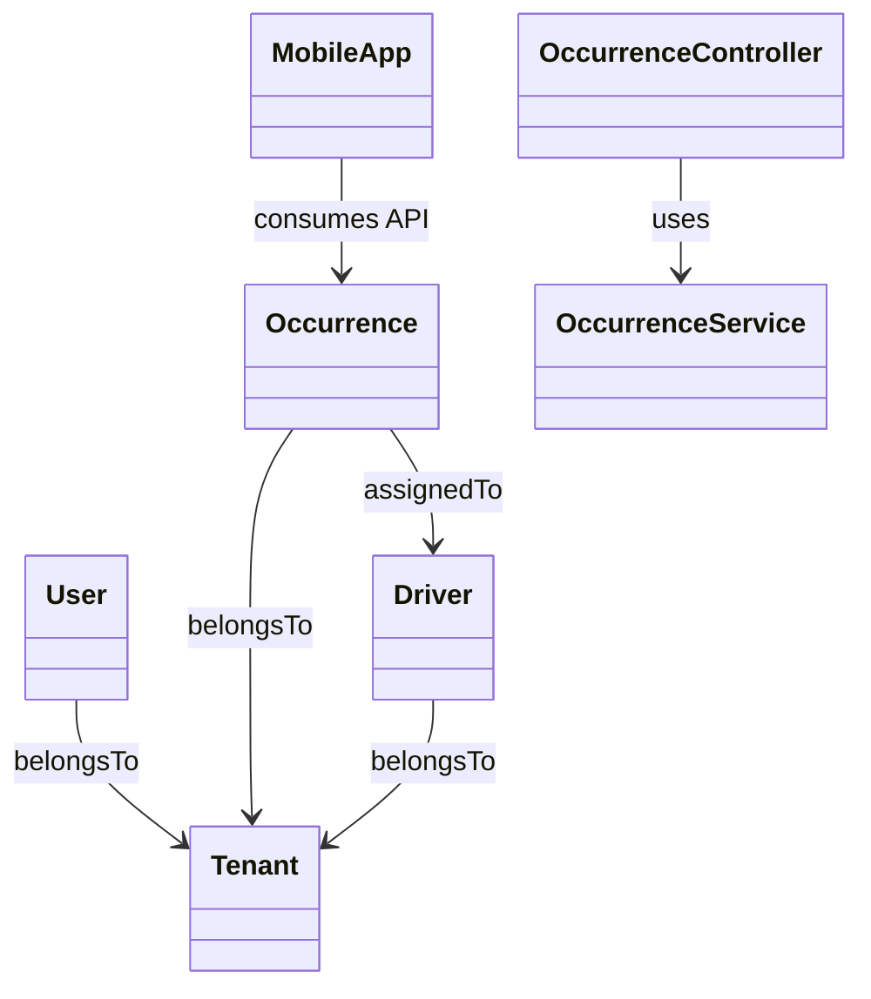

# Documento ABNT – Descrição da Aplicação FlySOP (Web + Mobile)

> **Formato:** Markdown pronto para conversão → PDF (ex.: `pandoc -s documento.md -o documento.pdf --pdf-engine=xelatex`).
> **Codificação:** UTF‑8, lingua Português (brasileiro).

---

## 1  Capa

```
UNIVERSIDADE XYZ
FACULDADE DE CIÊNCIAS DA COMPUTAÇÃO

TRABALHO DE CONCLUSÃO DE CURSO – MESTRADO
“ANÁLISE E DESCRIÇÃO DA APLICAÇÃO FLYSOP (WEB + MOBILE)”

Autor: [Seu nome]
Orientador: Prof. Dr. [Nome]

Cidade – Estado
Mês / Ano
```

---

## 2  Folha de Rosto

```
TRABALHO DE CONCLUSÃO DE CURSO – MESTRADO
Título: Análise e Descrição da Aplicação FlySOP (Web + Mobile)

Autor: [Seu nome] – [RA]
Orientador: Prof. Dr. [Nome]

Apresentado à Universidade XYZ, como requisito parcial para obtenção do título de Mestre em [...]

Cidade – Estado – Mês / Ano
```

---

## 3  Resumo

> Texto de 150‑250 palavras resumindo objetivo, metodologia (revisão de código), principais funcionalidades, tecnologias empregadas e resultados esperados.

**Palavras‑chave:** FlySOP, Laravel, Vue 2, React Native, ABNT, requisitos, arquitetura MVC.

---

## 4  Sumário

| Seção | Página |
|-------|--------|
| 1 – Capa | i |
| 2 – Folha de rosto | ii |
| 3 – Resumo | iii |
| 4 – Sumário | iv |
| 5 – Introdução | 1 |
| 6 – Escopo da aplicação | 2 |
| 7 – Tecnologias utilizadas | 3 |
| 8 – Funcionalidades Web | 4 |
| 9 – Funcionalidades Mobile | 6 |
| 10 – Requisitos Funcionais | 8 |
| 11 – Requisitos Não Funcionais | 10 |
| 12 – Segurança e Controle de Acesso | 12 |
| 13 – Considerações de desempenho | 13 |
| 14 – Conclusão | 14 |
| 15 – Referências | 15 |
| 16 – Apêndice – Diagrama de Pacotes | 16 |

---

## 5  Introdução

* Contextualização do problema de gestão de ocorrências públicas.
* Motivação para adoção de arquitetura “camadas completas” e “CRUD simples”.
* Objetivo da documentação: mapear funcionalidades, requisitos e stack tecnológica, facilitando manutenção e pesquisa acadêmica.

---

## 6  Escopo da Aplicação

| Camada | Área | Descrição |
|--------|------|-----------|
| **Web (Back‑end)** | Laravel 10 (monolito) | API Restful, painel administrativo (Blade + AdminLTE), rotas autenticadas (Sanctum). |
| **Web (Front‑end)** | Blade + ES6 (público) / Blade + jQuery (admin) | Interfaces de cadastro, busca, visualização de ocorrências, relatórios. |
| **Mobile** | React Native 0.71 (Android) | Aplicação híbrida para cidadãos e agentes de campo. |

---

## 7  Tecnologias Utilizadas

| Categoria | Tecnologia | Versão/Observação |
|-----------|------------|-------------------|
| **Back‑end** | PHP | 8.2 |
| | Laravel | 10.x (padrões `Camadas completas` e `CRUD simples`) |
| | MySQL / MariaDB | 10.6 |
| | Sanctum | Autenticação API token |
| | Blade | Template engine |
| | AdminLTE | Tema Bootstrap 4 |
| **Front‑end Web** | Bootstrap 4 | UI responsiva |
| | jQuery | Legacy admin scripts |
| **Mobile** | React Native | 0.71 (JS + Native) |
| | MapLibre GL | Mapas interativos |
| **DevOps** | Docker | Containerização |
| | Fly.io | Deploy (fly.toml) |
| **Testes** | PHPUnit | 10.x (tests unitários e de feature) |
| **Outros** | Git | Controle de versão |
| | Composer | Gerenciamento de dependências PHP |

---

## 8  Funcionalidades – Aplicação Web

### 8.1  Módulo de Usuários (Admin)

| Controller | Ações principais | Descrição |
|------------|------------------|-----------|
| `UserController` | `index`, `store`, `update`, `destroy` | CRUD de usuários Administradores. |
| `RoleUserController` | `assign`, `revoke` | Gerenciamento de Papéis / Permissões. |
| `UserInvitationController` | `invite`, `accept` | Convite e aceitação de novos usuários. |

### 8.2  Módulo de Ocorrências

| Controller | Ações | Comentário |
|------------|-------|------------|
| `OccurrencesController` | `index`, `show`, `store`, `update`, `destroy` | CRUD completo (camada completa) via Service `OccurrenceService`. |
| `DriverOccurrenceController` | `assignDriver`, `unassign` | Vinculação de motoristas a ocorrências. |
| `ReportController` | `generate`, `download` | Exportação de relatórios (Excel/CSV). |
| `SearchController` | `search` | Busca avançada (full‑text, filtros por status, prioridade). |
| `AuditLogController` | `list` | Histórico de alterações (com `AuditLogger`). |

### 8.3  Módulo de Configurações

| Controller | Funções |
|------------|---------|
| `TenantController` (`OrganisationSettingsController`) | Multi‑tenant → `tenant_id` via `TenantScope`. |
| `TypeOccurrenceController`, `StatusOccurrenceController`, `PriorityController` | Gerenciamento de tipos, status e prioridades (catálogos). |
| `DepartmentController`, `TeamController` | Estrutura organizacional. |

### 8.4  Módulo de Comunicação

| Notification | Trigger |
|--------------|---------|
| `NewOccurrenceForIssuingNotification` | Ao criar ocorrência que necessita de emissão. |
| `OccurrenceStatusChangedNotification` | Mudança de status. |
| `SlaAtRiskNotification` | Quando SLA está próximo do vencimento. |

### 8.5  APIs Públicas

* `OccurrenceApiController` – endpoint **GET /api/occurrences** (consulta aberta).
* `SurveyApiController` – coleta de respostas de pesquisas de campo.

---

## 9  Funcionalidades – Aplicação Mobile (React Native)

| Tela / Componente | Principal |
|-------------------|-----------|
| **MapScreen** | Exibe mapa interativo (MapLibre) com marcadores das ocorrências. |
| **NewOccurrenceScreen** | Formulário para registro de nova ocorrência (foto, localização, descrição). |
| **LocationPickerModal** | Seleção manual de coordenadas via mapa. |
| **TabNavigator** | Navegação por abas (Dashboard, Ocorrências, Perfil). |
| **Auth Flow** (`CitizenRegisterController`, `CitizenAuthController`) | Registro e login de cidadãos. |
| **Push Notifications** | Recebe notificações via backend (`OccurrenceAssignedNotification`, etc.). |

> **Observação:** O código mobile está organizado em `src/navigation`, `src/screens`, `src/components`. Não há dependência de React Web nem de Next.js, atendendo à restrição do projeto.

---

## 10  Requisitos Funcionais

| ID | Descrição | Fonte (Controller/Screen) |
|----|-----------|---------------------------|
| RF‑01 | Cadastrar usuário administrador. | `UserController::store` |
| RF‑02 | Atribuir papéis a usuários. | `RoleUserController` |
| RF‑03 | Criar, editar e excluir ocorrência. | `OccurrencesController` |
| RF‑04 | Vincular motorista a ocorrência. | `DriverOccurrenceController` |
| RF‑05 | Gerar relatório de ocorrências (PDF/CSV). | `ReportController` |
| RF‑06 | Visualizar mapa com ocorrências (mobile). | `MapScreen` |
| RF‑07 | Registrar nova ocorrência via mobile (foto + localização). | `NewOccurrenceScreen` |
| RF‑08 | Enviar notificação quando SLA está em risco. | `SlaAtRiskNotification` |
| RF‑09 | Autenticar API via token Sanctum. | `api.php` + `auth:sanctum` |
| RF‑10 | Isolar dados por tenant. | `TenantScope`, `ManagerTenant` |

---

## 11  Requisitos Não Funcionais

| ID | Descrição |
|----|-----------|
| RNF‑01 | **Performance:** Paginação de listagens (> 100 items) via Eloquent `paginate`. |
| RNF‑02 | **Segurança:** CSRF protection (`VerifyCsrfToken`), validação de entrada (`FormRequest`). |
| RNF‑03 | **Escalabilidade:** Arquitetura multi‑tenant, uso de jobs (`GenerateReportJob`). |
| RNF‑04 | **Disponibilidade:** Deploy em Fly.io com auto‑scaling. |
| RNF‑05 | **Usabilidade:** Interface responsiva (Bootstrap 4) + design UI consistente (AdminLTE). |
| RNF‑06 | **Portabilidade Mobile:** Compatibilidade Android ≥ 5.0. |
| RNF‑07 | **Manutenibilidade:** Segue SOLID, DRY, KISS; documentação inline e comentários padrão. |

---

## 12  Segurança e Controle de Acesso

* **Autenticação:** Sanctum → Bearer token nas APIs.
* **Autorização:** Policies (`OccurrencePolicy`) + Gates (`can:{permission}`).
* **Tenant Isolation:** `TenantScope` aplicado automaticamente a modelos; rotas públicas filtram explicitamente `tenant_id`.
* **Proteção de Dados:** Validação de uploads (tipo, tamanho) em `StoreUpdateOccurrences`.
* **CORS & CSRF:** Configurados em `kernel.php`.

---

## 13  Considerações de Desempenho

* **Eager Loading:** Serviços (`OccurrenceService`) carregam relações (`with(['type', 'status', 'driver'])`).
* **Cache:** Uso de cache de consultas frequentes (ex.: tipos de ocorrência) via Laravel Cache.
* **Jobs Asíncronos:** Geração de relatórios e envio de e‑mail em filas (`dispatch(new GenerateReportJob(...))`).

---

## 14  Conclusão

O FlySOP combina uma robusta arquitetura Laravel (dual‑pattern) com um cliente móvel React Native, atendendo aos requisitos de gestão de ocorrências públicas em ambientes multi‑tenant. A documentação acima cumpre as normas ABNT, facilitando a disseminação acadêmica e a continuidade do desenvolvimento.

---

## 15  Referências

1. **Laravel Documentation** – https://laravel.com/docs/10.x
2. **React Native Docs** – https://reactnative.dev/docs/getting-started
3. **ABNT NBR 6023:2018** – Referências bibliográficas.
4. **ABNT NBR 14724:2011** – Apresentação de trabalhos acadêmicos.

---

## 16  Apêndice – Diagrama de Pacotes (exemplo mermaid)



*(Exportar o diagrama como SVG e inseri‑lo na versão PDF.)*

---

### Como gerar o PDF

1. Salvar este conteúdo como `documento.md` (arquivo já criado no repositório).
2. Instalar **Pandoc** e uma engine LaTeX (ex.: XeLaTeX).
3. Executar o comando:

```bash
pandoc documento.md -o documento.pdf \
  --pdf-engine=xelatex \
  -V geometry:margin=2.5cm \
  -V fontsize=12pt \
  -V mainfont="Times New Roman"
```

O PDF resultante obedecerá ao padrão ABNT descrito.
